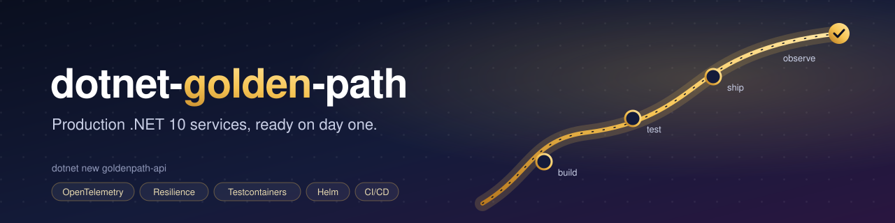
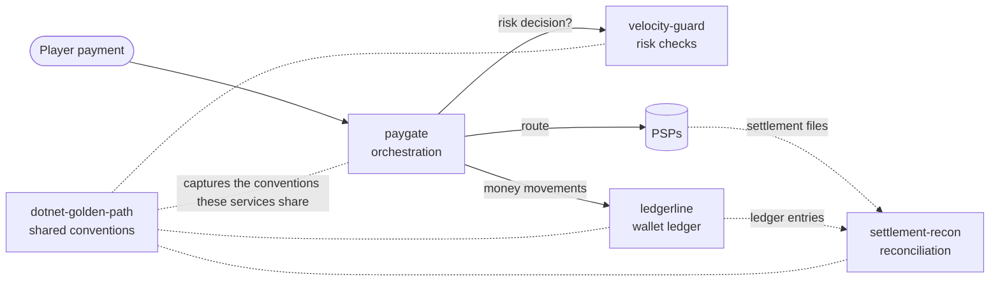
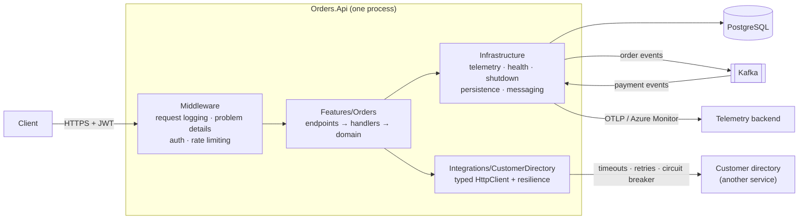
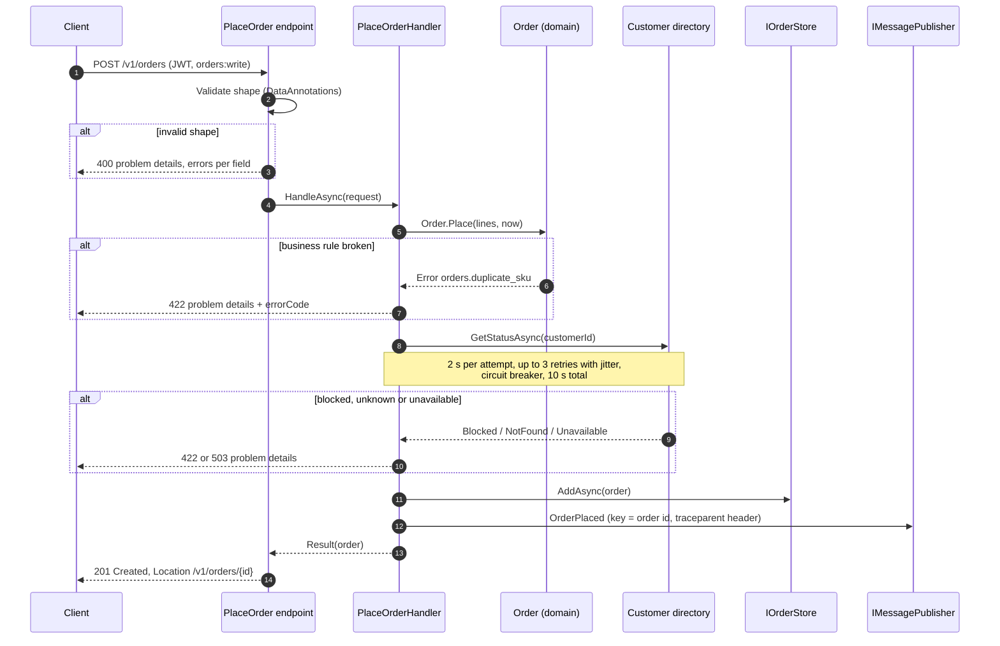
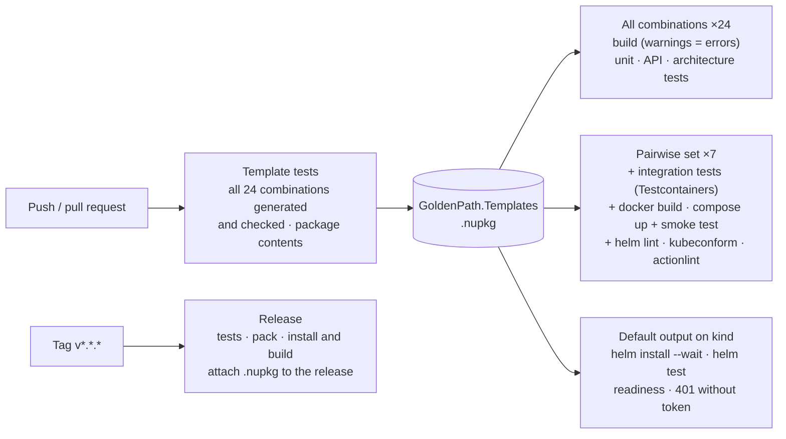

<div align="center">



# 🛤️ dotnet-golden-path

**A `dotnet new` template for production .NET 10 services: OpenTelemetry, Serilog, resilience, health probes, Testcontainers, a chiseled Docker image, a Helm chart and CI, ready on day one.**

[](https://github.com/AutumnTrace/dotnet-golden-path/actions/workflows/ci.yml)
[](https://github.com/AutumnTrace/dotnet-golden-path/releases)


[](LICENSE)

[Quick start](#-quick-start) · [What you get](#-what-you-get-on-day-one) · [Options](#%EF%B8%8F-options) · [Architecture](#-architecture) · [Examples](#-example-requests-and-responses) · [Handbook](docs/handbook/README.md) · [Changelog](CHANGELOG.md)

</div>

## 💡 Why this exists

Every new service starts the same way: someone copies the last one, deletes the business logic and keeps whatever
logging, retries and Dockerfile it happened to have. Six months later no two services log alike, half of them call
dependencies without timeouts, and the newest Helm chart still runs as root. On a payments platform that drift is
expensive, because incidents are counted in failed transactions and every gap shows up in an audit. This template
turns the conventions into a starting point that is tested on every change, so a new service is production-ready
on its first commit and looks like its neighbours.

## ✨ What you get on day one

| | |
|---|---|
| 🧩 **Vertical slices** | Minimal APIs organised by feature, with a sample Orders slice: domain rules, money as minor units plus ISO 4217 currency, UUIDv7 ids, keyset paging |
| 🧯 **Errors clients can act on** | RFC 9457 problem details everywhere, a stable `errorCode`, the `traceId`; `400` for shape, `422` for business rules, `409` for state and concurrency |
| 🔭 **One telemetry pipeline** | Serilog formats and enriches logs and feeds OpenTelemetry; traces, metrics and logs go to OTLP and/or Azure Monitor, switched on by configuration |
| 🛡️ **Resilience** | Typed `HttpClient` with timeouts, retries with jitter and a circuit breaker; no retries for unsafe methods; per-client rate limiting; graceful shutdown that drains before stopping |
| ❤️ **Health probes** | `/health/live` (no checks) and `/health/ready` (own database and broker only, fails while draining) |
| 🔐 **Secure by default** | JWT bearer with scope policies and a deny-by-default fallback; local tokens only in Development; startup fails on missing or invalid configuration |
| 🗄️ **PostgreSQL** (`--database`) | EF Core 10, migrations, order lines as a `jsonb` complex collection, `xmin` optimistic concurrency, snake_case naming |
| 📨 **Kafka** (`--messaging`) | Outbox-ready message envelope, idempotent producer, at-least-once consumer, retries then a dead-letter topic, W3C trace context in headers |
| 🧪 **Tests at every level** | Unit, API (`WebApplicationFactory`), architecture (ArchUnitNET), OpenAPI contract snapshot, Testcontainers integration tests |
| 🐳 **Chiseled image** | Multi-stage `Dockerfile`, non-root, no shell, read-only root file system; a compose stack with the Aspire dashboard |
| ☸️ **Helm chart** | Probes, requests and limits, HPA, PDB, ConfigMap, a token-less ServiceAccount, a restricted security context and `helm test` |
| 🔁 **CI from the first push** | A generated GitHub Actions workflow (build, tests, coverage, image, compose and chart validation) and Dependabot |
| 📚 **Engineering handbook** | [How we build services](docs/handbook/README.md): logging and tracing, errors, resilience, testing, code review, ADRs, onboarding |

## 🧩 Part of Payments Lab

Five .NET 10 services for the payments side of a B2B iGaming platform. Each repository runs and tests on its own.

| Repository | What it does |
|---|---|
| [paygate](https://github.com/AutumnTrace/paygate) | Payment orchestration gateway: PSP routing and failover, Polly circuit breakers, idempotent REST API, signed webhooks |
| [ledgerline](https://github.com/AutumnTrace/ledgerline) | Double-entry wallet ledger: DDD + CQRS on EF Core/PostgreSQL, optimistic concurrency, transactional outbox to Kafka |
| [settlement-recon](https://github.com/AutumnTrace/settlement-recon) | Settlement reconciliation engine: streams PSP settlement files against the ledger, explains every mismatch |
| [velocity-guard](https://github.com/AutumnTrace/velocity-guard) | Real-time payment risk and velocity checks on Redis: sliding windows, HybridCache, sub-millisecond rule evaluation |
| **[dotnet-golden-path](https://github.com/AutumnTrace/dotnet-golden-path)** | **`dotnet new` template for production .NET services: OpenTelemetry, Serilog, resilience, Testcontainers, Docker, Helm, CI (you are here)** |



The four services were not generated from this template; it captures the conventions they share (problem details,
OpenTelemetry, resilience defaults, health probes, chiseled images, Testcontainers) so the next service starts there.

## 🚀 Quick start

### 1. Install the template

**From the release package** (no clone needed):

```bash
gh release download v0.1.0 --repo AutumnTrace/dotnet-golden-path --pattern "*.nupkg"
dotnet new install GoldenPath.Templates.0.1.0.nupkg
```

Without the GitHub CLI: download `GoldenPath.Templates.0.1.0.nupkg` from the
[release page](https://github.com/AutumnTrace/dotnet-golden-path/releases/tag/v0.1.0) and run the same
`dotnet new install` command. The package is not on nuget.org.

**From a clone** (to try changes to the template):

```bash
git clone https://github.com/AutumnTrace/dotnet-golden-path.git
dotnet new install ./dotnet-golden-path/templates/goldenpath-api
```

### 2. Generate a service

```bash
dotnet new goldenpath-api -n Orders                         # PostgreSQL, OTLP, JWT (the defaults)
dotnet new goldenpath-api -n Payouts --messaging kafka --observability both
dotnet new goldenpath-api -n Pricing --database none --auth none
```

### 3. Run it

**A. Just .NET, no Docker.** In Development the database, the message bus and the downstream customer directory
have in-process stand-ins, so a fresh clone runs with one command:

```bash
cd Orders
dotnet run --project src/Orders.Api
TOKEN=$(curl -s -X POST http://localhost:5080/dev/tokens -H "Content-Type: application/json" -d '{}' \
  | sed -E 's/.*"accessToken":"([^"]+)".*/\1/')
curl -s http://localhost:5080/v1/orders -H "Authorization: Bearer $TOKEN"
```

**B. Docker Compose.** The service, PostgreSQL (and Kafka, if chosen) and the Aspire dashboard as telemetry UI:

```bash
docker compose up --build
# API http://localhost:8080 · traces, metrics, logs http://localhost:18888
```

**C. Kubernetes.** The chart is in `deploy/helm/orders`; CI installs it into a kind cluster on every change:

```bash
docker build -t <registry>/orders:0.1.0 . && docker push <registry>/orders:0.1.0
kubectl create secret generic orders-secrets --from-literal=ConnectionStrings__Database='Host=...'
helm install orders deploy/helm/orders \
  --set image.repository=<registry>/orders --set image.tag=0.1.0 \
  --set existingSecret=orders-secrets \
  --set config.Authentication__Schemes__Bearer__Authority=https://<your-identity-provider>
```

> [!TIP]
> Every generated service has its own README with the endpoints, every configuration key and the commands above,
> already filled in with its name.

## ⚙️ Options

| Option | Choices | Default | What it changes |
|---|---|---|---|
| `--database` | `postgres`, `none` | `postgres` | PostgreSQL with EF Core 10, migrations, optimistic concurrency (`xmin`) and a readiness check. Local runs use an in-memory store, so no Docker is needed. |
| `--messaging` | `kafka`, `none` | `none` | Kafka producer and at-least-once consumer behind an outbox-friendly `IMessagePublisher`, with retries, a dead-letter topic and trace propagation. Local runs use an in-memory bus. |
| `--observability` | `otlp`, `appinsights`, `both` | `otlp` | Telemetry exporters. Each one switches on only when its endpoint (`OTEL_EXPORTER_OTLP_ENDPOINT`) or connection string (`APPLICATIONINSIGHTS_CONNECTION_STRING`) is set. |
| `--auth` | `jwt`, `none` | `jwt` | JWT bearer auth with scope policies and a secure-by-default fallback policy, or no auth for services behind an authenticating gateway. |

All 24 combinations are built and tested in CI. Why only four options: [ADR 0005](docs/adr/0005-template-option-design.md).

## 🏗 Architecture

### The generated service



Slices never reference each other; `Infrastructure` and `Integrations` never reference slices; the domain knows
nothing about HTTP, EF Core or Kafka. The architecture tests fail the build otherwise
([ADR 0001](docs/adr/0001-vertical-slices.md)).

### Placing an order



With `--messaging kafka` the same slice consumes `PaymentCaptured` events and marks the order paid; redelivery is
harmless and a payment that does not match the order total is refused and logged, not retried.

### How this repository tests the template



The seven deep combinations cover every pair of option values at least once, plus "everything on".

## 🧪 Example requests and responses

Captured from a service generated with the default options (`dotnet new goldenpath-api -n Orders`), running with
`dotnet run` in Development.

<details open>
<summary><b>Place an order</b>: <code>201</code> with a <code>Location</code> header</summary>

```bash
TOKEN=$(curl -s -X POST http://localhost:5080/dev/tokens -H "Content-Type: application/json" -d '{}' \
  | sed -E 's/.*"accessToken":"([^"]+)".*/\1/')

curl -i -X POST http://localhost:5080/v1/orders -H "Authorization: Bearer $TOKEN" -H "Content-Type: application/json" \
  -d '{"customerId":"cust-42","currency":"EUR","lines":[{"sku":"SKU-1","quantity":2,"unitPriceMinor":1250},{"sku":"SKU-2","quantity":1,"unitPriceMinor":499}]}'
```

```http
HTTP/1.1 201 Created
Content-Type: application/json; charset=utf-8
Location: /v1/orders/01a2089a-7546-7703-a9e8-33bdd1f0049b
api-supported-versions: 1.0

{"id":"01a2089a-7546-7703-a9e8-33bdd1f0049b","customerId":"cust-42","currency":"EUR","status":"Placed","totalMinor":2999,"lines":[{"sku":"SKU-1","quantity":2,"unitPriceMinor":1250,"totalMinor":2500},{"sku":"SKU-2","quantity":1,"unitPriceMinor":499,"totalMinor":499}],"placedAt":"2026-11-23T13:31:10.022724+00:00","paidAt":null,"cancelledAt":null,"cancellationReason":null}
```
</details>

<details>
<summary><b>Shape errors</b>: <code>400</code>, one entry per field</summary>

```bash
curl -X POST http://localhost:5080/v1/orders -H "Authorization: Bearer $TOKEN" -H "Content-Type: application/json" \
  -d '{"customerId":"","currency":"eur","lines":[{"sku":"SKU-1","quantity":0,"unitPriceMinor":1250}]}'
```

```json
{"type":"https://tools.ietf.org/html/rfc9110#section-15.5.1","title":"One or more validation errors occurred.","status":400,"instance":"POST /v1/orders","errors":{"CustomerId":["The CustomerId field is required."],"Currency":["Currency must be an ISO 4217 code such as EUR."],"Lines[0].Quantity":["The field Quantity must be between 1 and 10000."]},"traceId":"7f066533093c0fe287f64604d76edb1e"}
```
</details>

<details>
<summary><b>A business rule</b>: <code>422</code> with a stable <code>errorCode</code></summary>

```bash
curl -X POST http://localhost:5080/v1/orders -H "Authorization: Bearer $TOKEN" -H "Content-Type: application/json" \
  -d '{"customerId":"cust-42","currency":"EUR","lines":[{"sku":"SKU-1","quantity":1,"unitPriceMinor":100},{"sku":"sku-1","quantity":1,"unitPriceMinor":100}]}'
```

```json
{"type":"https://tools.ietf.org/html/rfc4918#section-11.2","title":"Request cannot be processed","status":422,"detail":"SKU 'SKU-1' appears on more than one line; combine the quantities instead.","instance":"POST /v1/orders","errorCode":"orders.duplicate_sku","traceId":"d30b61ed792a564fd97628ac2b4f237b"}
```
</details>

<details>
<summary><b>Cancel, then list by status</b>: idempotent cancel, keyset paging</summary>

```bash
curl -X POST http://localhost:5080/v1/orders/01a2089a-7546-7703-a9e8-33bdd1f0049b/cancel \
  -H "Authorization: Bearer $TOKEN" -H "Content-Type: application/json" -d '{"reason":"customer changed their mind"}'
curl "http://localhost:5080/v1/orders?customerId=cust-42&status=Cancelled&limit=10" -H "Authorization: Bearer $TOKEN"
```

```json
{"items":[{"id":"01a2089a-7546-7703-a9e8-33bdd1f0049b","customerId":"cust-42","currency":"EUR","status":"Cancelled","totalMinor":2999,"lines":[{"sku":"SKU-1","quantity":2,"unitPriceMinor":1250,"totalMinor":2500},{"sku":"SKU-2","quantity":1,"unitPriceMinor":499,"totalMinor":499}],"placedAt":"2026-11-23T13:31:10.022724+00:00","paidAt":null,"cancelledAt":"2026-11-23T13:31:10.210653+00:00","cancellationReason":"customer changed their mind"}],"nextCursor":null}
```
</details>

<details>
<summary><b>No token</b>: <code>401</code>, still problem details</summary>

```bash
curl http://localhost:5080/v1/orders
```

```json
{"type":"https://tools.ietf.org/html/rfc9110#section-15.5.2","title":"Unauthorized","status":401,"instance":"GET /v1/orders","traceId":"31fcaafdfeeb7ff7e77d4451b1fe17a3"}
```

A token with only `orders:read` gets `403` on `POST /v1/orders`.
</details>

<details>
<summary><b>Fail fast</b>: production without its configuration does not start</summary>

```bash
ASPNETCORE_ENVIRONMENT=Production dotnet Orders.Api.dll
```

One structured line, then a non-zero exit code (exception text shortened):

```json
{"@m":"Service terminated unexpectedly","@l":"Fatal","@x":"System.AggregateException: One or more errors occurred. (Authentication:Schemes:Bearer needs an Authority (your identity provider) or signing keys.) (DataAnnotation validation failed for 'DatabaseOptions' members: 'ConnectionString' with the error: 'ConnectionStrings:Database is required when Database:Provider is Postgres.'.) ..."}
```
</details>

## 🧠 Design decisions

- **Vertical slices, enforced by tests.** One folder per capability; no mediator; architecture tests keep the
  boundaries. [ADR 0001](docs/adr/0001-vertical-slices.md)
- **OpenTelemetry is the only telemetry API.** Serilog formats, OpenTelemetry exports; the backend is a
  configuration choice. [ADR 0002](docs/adr/0002-opentelemetry-single-telemetry-api.md)
- **Chiseled, non-root, read-only.** No shell to exploit, nothing to patch that the service does not use.
  [ADR 0003](docs/adr/0003-chiseled-container-images.md)
- **Resilience defaults with reasons.** Every timeout and retry number is in configuration and explained; readiness
  never checks other services. [ADR 0004](docs/adr/0004-resilience-defaults.md)
- **Four options, all 24 combinations tested.** A template that generates broken code once loses its users' trust.
  [ADR 0005](docs/adr/0005-template-option-design.md)

<details>
<summary><b>Smaller choices</b></summary>

- **Built-in .NET 10 minimal API validation** instead of a validation library: one dependency fewer, and the errors
  arrive as standard validation problem details.
- **`Result<T>` for expected failures, exceptions for bugs.** Handlers return values the endpoint maps to status
  codes; nothing expected is thrown.
- **UUIDv7 ids and keyset paging.** Time-ordered keys keep B-tree inserts cheap and give stable cursors without
  `OFFSET` scans.
- **Timestamps at microsecond precision**, PostgreSQL's resolution, so a `201` body and a later `GET` agree.
- **An in-memory store that hands out copies**, like a database would, so local runs and tests cannot depend on
  shared mutable instances.
- **Framework-aligned packages stay on the .NET 10 line.** Dependabot ignores .NET 11 majors for ASP.NET Core, EF
  Core and friends; they move together with the target framework.
- **No Verify for the contract snapshot.** Verify 33 requires every consuming build to declare a paid sponsorship
  or a licence exemption; a template would hand that obligation to every service generated from it. A 60-line
  approval helper does the job.
</details>

## ✅ Testing

### In every generated service

| Layer | Project | Needs Docker | Count (everything on) |
|---|---|---|---|
| Unit: domain rules, handlers, resilience pipeline, messaging dispatcher, shutdown | `*.UnitTests` | no | 80 |
| API: the real app in memory, auth, problem details, rate limiting, telemetry, OpenAPI snapshot | `*.ApiTests` | no | 42 |
| Architecture: slice boundaries and dependency rules | `*.ArchitectureTests` | no | 8 |
| Integration: PostgreSQL and Kafka in Testcontainers | `*.IntegrationTests` | yes | 9 |

Counts depend on the options: the defaults give 72 + 39 + 7 + 5, and `--database none --messaging none --auth none`
gives 65 + 26 + 6 with no integration project.

```bash
dotnet test --filter "Category!=Integration"   # no Docker needed
dotnet test --filter "Category=Integration"    # Testcontainers
```

### In this repository

```bash
dotnet test                       # 249 template tests: every combination generated and checked, package contents
eng/verify-combinations.sh        # pack, install into a throwaway hive, build and test all 24 combinations
```

Neither touches your real `dotnet new` configuration. CI additionally runs the integration tests, the container
build, the compose stack and the Kubernetes deployment described [above](#how-this-repository-tests-the-template).

### Observability you can assert on

| Signal | What the service emits |
|---|---|
| Traces | ASP.NET Core server spans (`http.route`, `order.id`), `HttpClient`, Npgsql, Kafka producer and consumer spans following the messaging conventions; probes are not traced |
| Metrics | `orders.placed` (by currency), `orders.cancelled`, `orders.paid`, `messaging.messages.processed` (by type and outcome), ASP.NET Core, `HttpClient`, runtime, Polly and Npgsql meters |
| Logs | One request summary line per request, business events with stable event ids (`1001` order placed, ...), JSON in production with trace and span ids |

The API tests assert on the request span and the business counter with the in-memory exporter and
`MetricCollector<T>`.

## 📁 What gets generated

`dotnet new goldenpath-api -n Orders --messaging kafka` produces:

```
Orders/
├── src/Orders.Api/
│   ├── Program.cs                      # composition root: one line per building block and per slice
│   ├── Features/Orders/                # the sample slice
│   │   ├── Domain/                     # Order aggregate, OrderLine, errors; no framework types
│   │   ├── PlaceOrder.cs · GetOrder.cs · ListOrders.cs · CancelOrder.cs
│   │   ├── MarkOrderPaid.cs            # message-triggered use case (PaymentCaptured)
│   │   ├── OrderMessages.cs            # topics and message contracts
│   │   └── Persistence/                # EF Core mapping and store
│   ├── Infrastructure/                 # Api · Errors · Health · Lifecycle · Messaging · Observability
│   │                                   # Persistence (+ Migrations) · RateLimiting · Security
│   ├── Integrations/CustomerDirectory/ # typed client, resilience, local stub
│   └── appsettings.json                # every default, including resilience numbers
├── tests/
│   ├── Orders.UnitTests/  Orders.ApiTests/  Orders.ArchitectureTests/  Orders.IntegrationTests/
│   └── Orders.Testing/                 # shared kit: in-memory host, tokens, API helpers
├── deploy/helm/orders/                 # Deployment, Service, HPA, PDB, ConfigMap, ServiceAccount, helm test
├── Dockerfile · .dockerignore · docker-compose.yml
├── .github/workflows/ci.yml · .github/dependabot.yml
├── .config/dotnet-tools.json           # dotnet-ef
├── Directory.Build.props · Directory.Packages.props · global.json · .editorconfig
└── Orders.slnx · README.md
```

This repository:

```
dotnet-golden-path/
├── templates/goldenpath-api/           # the template content (placeholder names Company.Service / company-service)
│   └── .template.config/template.json  # options, computed symbols, conditional files
├── src/GoldenPath.Templates/           # the packing project
├── tests/GoldenPath.Templates.Tests/   # template and package tests
├── eng/                                # verify-combinations.sh, smoke-test.sh, kind manifests
├── docs/handbook/ · docs/adr/          # engineering handbook and decision records
└── .github/workflows/                  # CI (matrix, compose, kind) and release
```

## 📚 Engineering handbook

How we build services, short and opinionated, with the reasons spelled out:

- [Onboarding: your first week](docs/handbook/onboarding.md)
- [Service anatomy: where code goes](docs/handbook/service-anatomy.md)
- [Logging, tracing and metrics](docs/handbook/observability.md)
- [Errors and validation](docs/handbook/error-handling.md)
- [Resilience: timeouts, retries, health, shutdown](docs/handbook/resilience.md)
- [Testing: the pyramid as generated](docs/handbook/testing.md)
- [Code review checklist](docs/handbook/code-review.md)
- [Architecture decision records: when and how](docs/handbook/adr.md) ([template](docs/adr/template.md))

## 🗺 Roadmap

- [ ] A transactional outbox implementation behind the existing `IMessagePublisher` for `--database postgres --messaging kafka`
- [ ] Migration bundle as a Helm pre-upgrade hook, instead of migrating on startup
- [ ] Native AOT variant once EF Core and the configuration binder are trim-clean for this stack
- [ ] A `goldenpath-worker` template for queue consumers without HTTP endpoints
- [ ] Moving the generated test projects to Microsoft.Testing.Platform

## 🤝 Contributing

See [CONTRIBUTING.md](CONTRIBUTING.md). Changes to a convention come with an ADR.

## 📄 License

[MIT](LICENSE) © Mina Rotari
